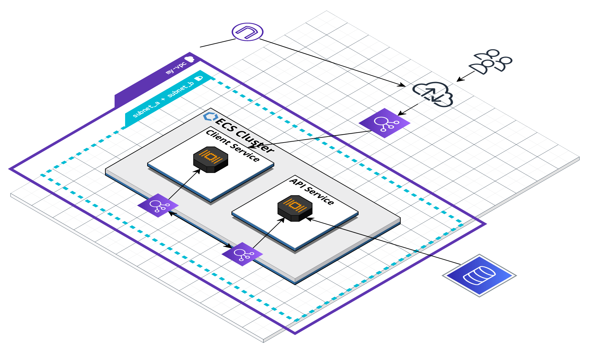
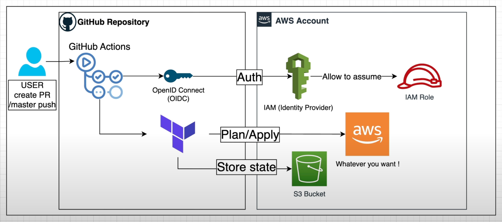
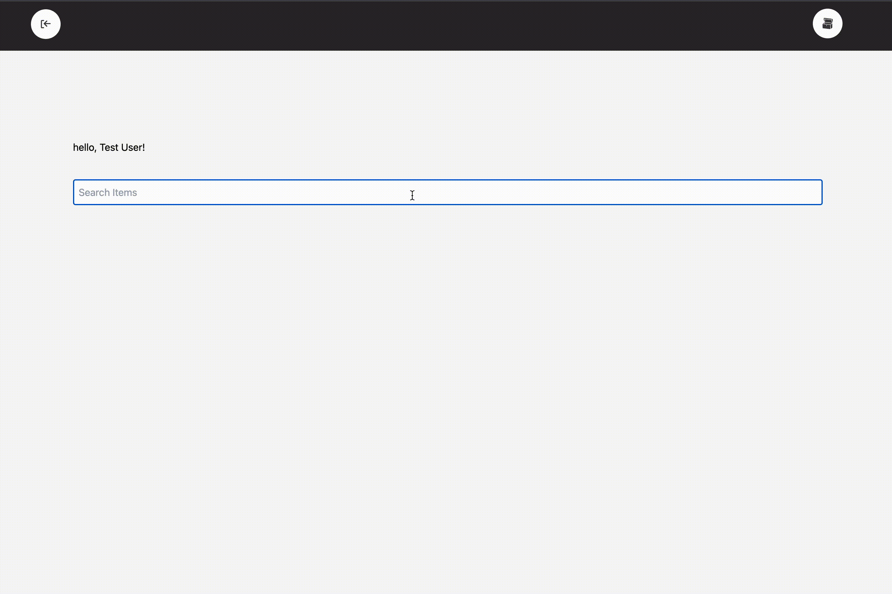

# D&D Inventory App


I developed this app with the goal of honing my skills as DevOps engineer. The app is a full-stack JavaScript/Node.js application that is containerized using Docker and deployed on AWS Elastic Container Service with Terraform. Its main functionality is to facilitate inventory management and item lookup in the standard Dungeons and Dragons playbook. With its convenient platform, the app streamlines the process for users to access and organize weapons and items.

## **Infrastructure**

My cloud infrastructure was created and managed using Terraform. It consists of two services that run on Amazon Elastic Container Service (ECS) using the AWS Fargate launch type. The services are defined by task definitions that include the Docker image for the service, the required resources (CPU/memory), and the environment variables needed by the containers.

Incoming traffic to the services is distributed using a Load Balancer (ALB), ensuring that the traffic is balanced and the services are highly available. The services are deployed in Virtual Private Cloud (VPC) subnets, providing enhanced security and network control.



\*Not currently deployed. The AWS infrastructure is torn down to avoid cost. Terraform is validated in CI, the deploy pipeline is manual and approval-gated, and the app runs locally with docker compose up (see Getting Started).

## **CI/CD**

<br>

My pipeline is split into two workflows: a CI workflow that runs automatically on every push and pull request, and a Deploy workflow that I trigger manually and that is gated behind an approval.

**CI Workflow:**

On every push to main and on pull requests, three jobs run:

- Server tests — installs dependencies and runs my Jest test suite against the server. This gates everything else: if the tests fail, no images are built.
- Terraform checks — because my AWS infrastructure isn’t deployed on every commit, static analysis is what keeps my Terraform honest. I run terraform fmt to enforce formatting, terraform validate to catch syntax and type errors, and tflint with the AWS ruleset to catch provider-specific mistakes like invalid Fargate CPU/memory combinations or deprecated arguments. The init here skips the S3 backend, so these checks need no AWS credentials.
- Build images — using a matrix, I build the client and server images in parallel. Each image is tagged by commit SHA (so every build is traceable to an exact commit), by branch, and with latest on the default branch. On pull requests the images are built but not pushed — this verifies they still compile without publishing throwaway images — and on pushes to main they’re published to GitHub’s Container Registry. Layer caching keeps repeat builds fast.

**Deploy Workflow:**

Deploys are deliberately manual and approval gated; they never run automatically. I start one from the Actions tab, and the job pauses on a protected production environment until a required reviewer approves it, so nothing reaches AWS without a human in the loop. A concurrency lock ensures two deploys can never run at once.

For credentials, I use OpenID Connect (OIDC) instead of long lived keys: GitHub Actions gets a JWT from the GitHub OIDC provider and exchanges it with AWS IAM for a short lived access token. From there, Terraform runs against an S3 backend that holds the state. The important part is that the deploy plans before it applies: terraform plan -out=tfplan saves the plan to a file, and terraform apply tfplan applies that exact file. What hits AWS is precisely what was planned and reviewed.



## D&D Inventory App

The Inventory app is built using React for the frontend and Node.js/Express for the backend API. The application utilizes Redux for state management and Sequelize for database interaction. The entire app is containerized with Docker and deployed onto AWS Elastic Container Service using Terraform. The app provides a convenient platform for inventory management and lookup of weapons and items in the standard Dungeons and Dragons playbook.
<br>
<br>


## **Key Features**

• React frontend with state management powered by Redux<br/>
• Node.js/Express backend API for data management and processing<br/>
• Secure user authentication and authorization using JWT<br/>
• Database integration with Postgres through the Sequelize ORM<br/>
• Containerization using Docker for easy deployment<br/>
• Deployment and infrastructure management using Terraform<br/>
• Continuous integration and deployment with GitHub Actions<br/>
• Automated testing using Jest<br/>
• Secure image storage in Github Container Registry<br/>
• Authorization and authentication using OpenID Connect (OIDC) between Github and AWS<br/>

## **Getting Started**

To start using the D&D Inventory App locally, please follow these steps:

1. Clone the repository

`git clone https://github.com/ofelix60/inventory-app.git`

2. Run the following command

`docker-compose -f docker-compose.dev.yml up`

## **Testing**

Testing runs automatically as part of the CI pipeline. The `test` job runs on every push to `main` and on every pull request, and it gates the image build, so images are only built if the test pass.

**Running these test locally**

```bash
cd server
npm ci          # install exact dependencies from package-lock.json
npm test        # run the suite
```

To run with a coverage report:

```bash
cd server && npx jest --coverage
```

## **Contributing**

If you have suggestions or improvements, please feel free to open a pull request or issue.
